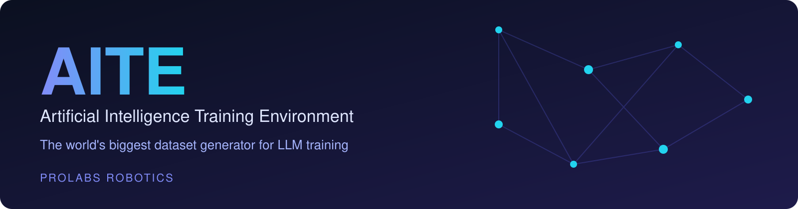
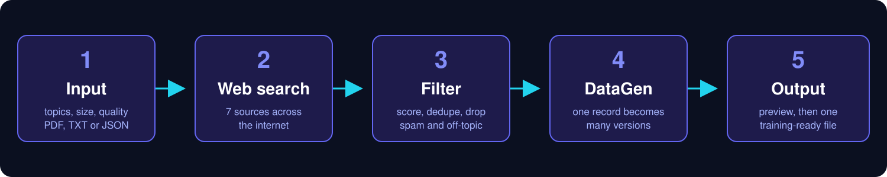
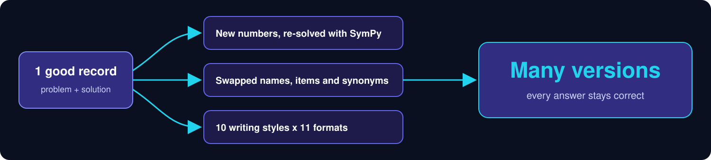

<p align="center">

</p>

<p align="center">


</p>

<p align="center">
<b>Overview</b> &nbsp;|&nbsp; <b>Three modes</b> &nbsp;|&nbsp; <b>How it works</b> &nbsp;|&nbsp; <b>Agent mode</b> &nbsp;|&nbsp; <b>Sources</b> &nbsp;|&nbsp; <b>DataGen</b> &nbsp;|&nbsp; <b>Train a model</b> &nbsp;|&nbsp; <b>Setup</b> &nbsp;|&nbsp; <b>Why AITE</b>
</p>

---

## Overview

> AITE (Artificial Intelligence Training Environment) by Prolabs Robotics is the world's biggest dataset generator for LLM training.

AITE finds problems and solutions across the internet, keeps only the best ones, and multiplies them into large training datasets that are ready to use.

The data it collects lives right here, in [`Dataset/`](Dataset). Agent mode updates it every 5 minutes, and the live numbers are in [`Dataset/README.md`](Dataset/README.md) and [`Dataset/stats.json`](Dataset/stats.json).

---

## Three Modes

| Mode | For | What it does |
| --- | --- | --- |
| **Agent** (default) | building a big dataset | Runs non-stop, collecting text, images and robot data on endless topics. It can only be paused, never stopped. |
| **Manual** | one exact dataset | Choose topics, quantity and quality, preview the result, then export one PDF, TXT or JSON file. |
| **Trainer** | your own AI model | Teaches an open AI model on your Mac with the collected data. No code needed. |

---

## How It Works

<p align="center">

</p>

| Step | Stage | What happens |
| --- | --- | --- |
| 1 | **Input** | Pick your topics, how many records you want, the quality level and a file type (PDF, TXT or JSON). |
| 2 | **Web search** | Collects material from Stack Exchange, Hugging Face, Wikibooks, arXiv, OpenAlex, Wikipedia and DuckDuckGo. |
| 3 | **Filter** | Scores every item and removes spam, duplicates, unanswered questions and off-topic content. |
| 4 | **DataGen** | Each record becomes many new versions (see below). |
| 5 | **Output** | Preview everything, then export one combined, training-ready file. |

---

## Agent Mode

Press **Start collecting** once. After that, AITE keeps building the dataset by itself, even while its window is closed, until you press **Pause**.

- **Endless, deep topics.** The topic engine covers 16 fields, from fundamentals to research level (étale cohomology, Iwasawa theory, Yang–Mills theory, BCS superconductivity, model predictive control...). It uses:
  - about 1,500 curated topics;
  - OpenAlex's 4,516 research topics and their roughly 45,000 keywords;
  - 64,723 OpenAlex concepts;
  - Wikipedia's links between ideas.

  Topics rotate field by field, mixing basic and advanced. Add your own *focus topics* to go first.
- **[`Dataset/topics.json`](Dataset/topics.json).** Every topic, with a ✓ when its data is complete. Topics being collected right now show *in progress* with their agent number. After a restart, or on another computer that clones this repo, collection continues with the topics still left.
- **Open Q&A archives.** Whole sites of the public Stack Exchange dump (10.8M human-written questions and answers, CC BY-SA), including MathOverflow, physics, chemistry, CS theory, electronics and statistics. Also MedMCQA, PubMedQA and ARC, with no daily quota.
- **Training-ready data.**
  - **Text:** chat-format question/answer rows, plus a plain `text` field, a fixed train/validation split, token counts, a quality tier, the field and the source licence.
  - **Preference pairs:** a better and a worse answer to the same question, from vote scores, ready for DPO.
  - **Web images:** free-licence images from Wikimedia Commons, each with its caption, author and licence.
  - **Generated images:** scenes with exact object boxes, outlines, captions and question/answer pairs, for object recognition.
  - **Robot VLA episodes:** pick-and-place runs with frames, actions and an instruction, for vision-language-action models.
- **Parallel agents.** 1,000 by default and up to 20,000. You can change the number while it runs. Above 1,500, extra worker processes start automatically, and each website's rate limit is shared between them. The **N agents** button in the top bar shows what every agent is doing and which website it is waiting on.
- **Big defaults.** Quality 10, 50 records per topic and 100 DataGen variations per record (up to 10,000).
- **GitHub first.** New data is committed to `main` every 5 minutes through a tiny upload copy. Once GitHub confirms a push, the local copies are deleted, so your computer keeps only the newest few minutes. A disk guard pauses collection if free space drops below 5 GB. GitHub caps repositories at about 5 GB, so data pushes stop at the budget in Settings > GitHub (stats and topics keep updating). TB-scale datasets need a dataset host such as Hugging Face Hub.
- **Live stats.** CPU, memory, network and counts are shown visually every second and pushed to this repo every 5 minutes.
- **Settings on the page.** Quality, records per topic, DataGen variations, CPU cap, data types and focus topics. Changes apply immediately.

## Products (all by ProLab Robotics)

Everything AITE does is grouped into products. Each one has its own switch in **Settings > Products**.

| Category | Products |
| --- | --- |
| Collection | **Parallel Web Technologies** · **AITE Agent** · **Topic Engine** · **Open Archives** · **Web Search** |
| Data quality | **Quality Filter** · **DataGen** · **Preference Pairs** |
| Vision & robotics | **Web Vision** · **Synthetic Vision** · **Robot VLA Studio** |
| Training & delivery | **LLM Trainer** · **GitHub Sync** · **Manual Studio** |

---

## Sources

<p align="center">

</p>

---

## DataGen

<p align="center">

</p>

Each good record becomes many new versions:

- **New numbers**, re-solved with SymPy so every answer stays correct.
- **Swapped names and items**, and synonyms.
- **10 writing styles x 11 formats.**

---

## Train a Model

Press **Train a model** (top bar, next to the two modes) and follow its six steps: get the trainer, choose a model, choose your data, train, try it, keep it.

AITE fine-tunes an open model **on your Mac** with Apple's MLX: no code and no cloud. You can pick any model:
- 16 built-in models (0.36B–14B, including maths, coding and reasoning models);
- models you have already downloaded;
- your own trained models, to keep training them;
- any MLX model id or folder.

- **Your data:** train on everything collected, or on a custom set. Choose the number of examples, the fields, the sources and topic keywords, then preview the set.
- **Try it:** your model **runs inside AITE**. Chat with the model before and after training side by side. Load held-back check questions and see each answer scored. **Compare on check questions** reports Before vs After as correct answers and closeness to the reference.
- **Keep it:** the finished model is saved as one folder that opens in LM Studio.

The full guide, in plain words plus a technical blueprint (data prep, SFT, DPO, evaluation, vision and robot models, cloud GPUs), is in **[TRAINING_BLUEPRINT.md](TRAINING_BLUEPRINT.md)**.

---

## Setup

```bash
git clone https://github.com/Aarav-111/Prolabs-Robotics-864-Dataset-.git
cd Prolabs-Robotics-864-Dataset-
python3 -m venv .venv && source .venv/bin/activate
pip install -r requirements.txt
python app/AITE.py                 # the app (Agent page opens first)
```

| Command | What it does |
| --- | --- |
| `python app/AITE.py` | Opens the app. |
| `python app/AITE.py --agent` | Agent mode without a window (e.g. on a server). |
| `python app/AITE.py --train --iters 200` | The Trainer without a window (Mac with Apple silicon). |
| `python app/AITE.py --run '{"topics":["algebra"],"quantity":10}' --out data.json` | One Manual-mode run. |
| `python app/AITE.py --selftest` | Offline self-test. |

**Pushing the dataset to GitHub.** Agent mode commits `Dataset/` (data, `stats.json`, `topics.json`, the live README) to `main` every 5 minutes. It uses your computer's normal git login; AITE stores no keys, tokens or passwords. To push somewhere else, change the repository link in **Settings > GitHub**.

---

## Why AITE

| Need | How AITE handles it |
| --- | --- |
| Scale | One good record is multiplied into many versions. |
| Quality | Spam, duplicates, unanswered questions and off-topic items are removed before anything is multiplied. |
| Correct answers | Changed numbers are re-solved with SymPy. |
| Variety | 10 writing styles and 11 formats per record. |
| Ready to use | Preview, then export one combined file as PDF, TXT or JSON. |
| Never stops | Agent mode collects day and night and only pauses when you say so. |
| Your own model | The Trainer turns the data into a fine-tuned model on your Mac. |
| Private and free | No API keys, no paid services; the trainer runs locally. |

---

<p align="center">
<b>AITE</b> by Prolabs Robotics<br>
<a href="mailto:prolabsrobotics@gmail.com">prolabsrobotics@gmail.com</a>
</p>
